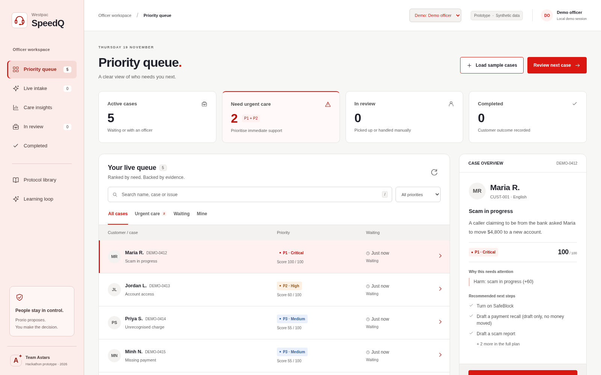
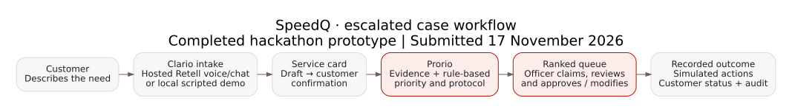
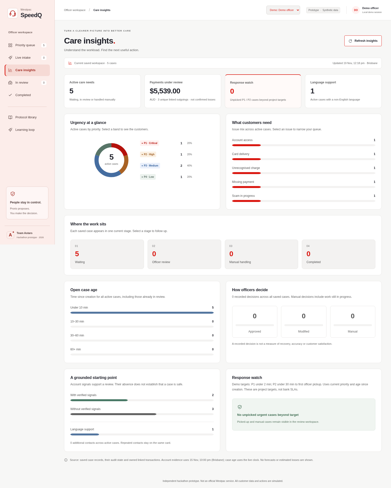

# SpeedQ — explainable customer-support triage

A customer conversation becomes a confirmed service card, an evidence-ranked queue and a clear starting point for an officer's decision.

**Completed hackathon prototype · Team Astars · Submitted 17 November 2026**
Built for the Westpac Innovation & Coding Competition 2026. Independent team project using synthetic customer data and simulated banking actions.

[Watch the submission video](https://youtu.be/2Sc_2JRPxVs) · [View the final pitch deck](docs/submission/Westpac-SpeedQ-Pitch-submitted.pptx) · [Run locally](#run-locally) · [Architecture](docs/architecture.md)



*Current officer workspace captured from an isolated, synthetic demonstration. The headset is original project artwork; no bank logo is used in the application.*

## The problem we tackled

A routine card-delivery question and an active scam need different kinds of help. A single arrival-order queue can hide that difference, while customers repeat their story and officers reconstruct context across handoffs.

| Pain point | What SpeedQ implements |
|---|---|
| Urgent harm competes with routine enquiries | Deterministic priority rules combine structured need, owned account evidence and bounded waiting adjustments. Each case shows its reasons. |
| Customers repeat information | Clario intake builds a service card that the customer can review and correct before escalation. |
| Officers start without context | A concise preview leads into evidence, proposed protocol, checks and an explicit human decision. |
| Two officers may pick up the same case | Server-enforced claims, revision checks, named handoffs and shared updates coordinate ownership. |
| Process improvements disappear | Officer changes can become suggestions; a human approves each protocol version. |

These are demonstrated workflows, not measured reductions in call time, fraud losses or customer wait times.

## How it works



Routine questions can finish during intake. Escalated needs become ranked cases. The customer conversation stays in its own app, with an optional preview under **Live intake** rather than a permanent chat column.

- **Clario:** conversation and structured intake through configured Retell voice/chat, with a local scripted demonstration available without credentials.
- **Prorio:** deterministic Python scoring, safety gates and protocol proposals. It is not a trained model; free-text summaries do not determine rank.
- **Officer workspace:** search and filters, explicit pickup, approve/modify/manual handling, customer progress, audit history and protocol review.
- **Care insights:** priority distribution, case stages, open age, evidence coverage and drill-downs computed from saved cases.

<details>
<summary>Explore the Care insights dashboard</summary>



</details>

## Try two scenarios

1. **Maria — scam in progress:** follow the case evidence and priority reasons, pick up the case, review the proposed response and record a simulated outcome.
2. **Sam — card delivery:** see the routine answer. In the scripted escalation scenario, Sam still asks for a person and receives a P4 case awaiting approval.

Open `/demo` for the officer-first demonstration, then **Live intake → View customer conversation** for the optional customer view. See the [demo guide](docs/demo.md) for reproduction and a two-officer handoff.

## Run locally

Requires **Python 3.12+**. The officer UI is plain HTML/CSS/JavaScript, served by FastAPI; no Node server or frontend build is needed.

### Windows

Download and **Extract All** of the repository ZIP, then double-click **START_WINDOWS.cmd**. Keep its terminal open. First setup installs Python dependencies and needs internet access.

Or run from the extracted repository in PowerShell:

```powershell
py -3 run_dashboard.py --demo
```

The launcher prints the local dashboard and demo addresses. Its default port is **8010**; if occupied by another application, choose `--port 8011`. A cloud machine's `127.0.0.1` is separate from your Windows computer.

### macOS / Linux

From the repository root:

```bash
python3 -m venv backend/.venv
source backend/.venv/bin/activate
python -m pip install -r backend/requirements.txt
cd backend
python -m uvicorn main:app --host 127.0.0.1 --port 8000
```

Open **http://127.0.0.1:8000/** or **http://127.0.0.1:8000/demo**. Use **Load sample cases → Add sample cases** for a populated queue. No Retell credentials are needed for scripted scenes.

[Full build and test guide](BUILD.md) · [Live-service configuration](docs/live-services.md)

## Architecture and scope

**Python · FastAPI · Pydantic · SQLite · HTML/CSS/JavaScript · Retell integration · Playwright/axe**

[View the component architecture diagram](assets/diagrams/architecture.svg) · [Browse the screenshot gallery](assets/screenshots/README.md)

The repository includes six synthetic customers, 31 transactions, six card records and 31 sourced protocols. SQLite persists cases, drafts, claims, audit history, mock state and approved protocol versions. The app is a **single-worker prototype**; event coordination and Retell conversation mappings are process-local.

| Included here | Requires external setup / outside this prototype |
|---|---|
| Officer and customer UI, scripted scenes, live Retell client/server integration | A Retell account, agent prompts, knowledge-base content, function configuration and reachable HTTPS endpoint |
| Deterministic ranking, protocol proposals and simulated actions | Real bank integrations, payments or verified fraud outcomes |
| Local demo identities and optional staff Basic authentication | Production customer verification, SSO/MFA and organisation roles |
| Automated backend/browser checks | Evidence of live call quality, phone transfer, officer usability or business impact |

The submitted recording is historical evidence. Live-service code is present, but the precise live voice/chat scope demonstrated in that recording has not been independently verified here. See [integration boundaries](docs/live-services.md), [architecture and limitations](docs/architecture.md) and [data provenance](backend/data/PROTOCOLS_SOURCES.md).

## Validation

From the repository root, with the Python environment active:

```bash
python tools/check_backend.py
```

For browser checks (Node **22.12+**):

```bash
cd frontend
npm ci
npx playwright install chromium
npm test
```

Seven backend suites and 103 browser checks passed during the 19 November 2026 cleanup validation. The browser checks include multi-officer interaction, responsive layouts and automated accessibility checks. They use isolated databases; Retell tests use a fake client and make no live calls. Manual accessibility/usability review and native Windows execution are separate from these local results. [Test details and CI](BUILD.md#validation).

## Team and submission

**Karan Rooprai (team lead), Amanraj Dhillon, Bharath Sampath, Aishwarya Naidu and Agamvir Bal.**

The team completed and submitted a narrated presentation-slide video on **17 November 2026**. The final deck has **14 slides**. The project was not selected for the next stage; no finalist or award claim is made. Personal responsibilities are not inferred from commit counts.

[Submission record and final deck](docs/submission/README.md) · [Portfolio and résumé wording](docs/portfolio.md)

## Documentation

- [BUILD.md](BUILD.md): installation, tests, routes and troubleshooting.
- [Architecture](docs/architecture.md): components, state, tradeoffs and production boundaries.
- [Demo guide](docs/demo.md): local scenarios and collaboration walkthrough.
- [Technical reference](docs/reference/TECHNICAL_REFERENCE.md): score rules, gates, protocols, APIs and settings.
- [Design](DESIGN.md), [feature/data review](FEATURE_REVIEW.md) and [branding](BRANDING.md).
- [Contributing](CONTRIBUTING.md), [third-party notices and licensing status](THIRD_PARTY_NOTICES.md).
- [Historical planning archive](docs/archive/README_INDEX.md): earlier plans retained with dated status.

## Beyond the hackathon

The submission is complete. Production identity, multi-worker coordination, live banking adapters, translation, surge grouping and field evaluation are possible extensions, not unfinished submission tasks. No deployment or real-customer use is claimed.

Team-authored code does not yet have a repository-wide licence. A public repository alone does not grant general reuse rights; third-party components retain their own terms. See [licensing status](THIRD_PARTY_NOTICES.md).
