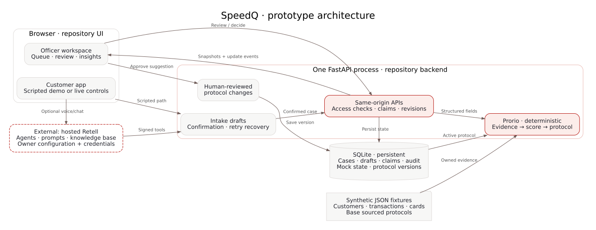

# Architecture and engineering decisions

SpeedQ is a completed hackathon prototype with two interfaces and one FastAPI process. Node is used for tests and screenshots, not to serve the product.

The [customer-support workflow](workflow.md) is a separate view of routing and human decisions; the architecture diagram above shows technical components and state.

## Components

| Component | Responsibility | Source |
|---|---|---|
| Officer workspace | Queue, case review, insights, ownership, protocols and learning loop | `frontend/` |
| Customer/demo | Scripted scenes, customer status and optional live voice/chat | `web/` |
| Clario adapter | Session creation, signed Retell tools and scoped customer lookup | `backend/clario_live.py` |
| Prorio | Structured evidence, score gates, priority and protocol proposal | `backend/prorio/` |
| Case store | Ownership, revision checks, decisions and audit history | `backend/store.py` |
| Durable intake | Unranked drafts, confirmation and retry association | `backend/intake_drafts.py` |
| Persistence | SQLite state and approved protocol versions | `backend/db.py` |

## State and time

SQLite retains cases, claims/revisions, drafts, audit history, mock account state, suggestions and approved protocol versions. Source synthetic records and base protocols are JSON files in `backend/data/`; the application does not rewrite `protocols.json`.

The store lock and event revision counter are process-local. Retell conversation mappings are in memory and do not survive a restart. Therefore run a single backend worker; database persistence alone does not make this a multi-instance service.

Account evidence uses a fixed demo clock, default **15 November 2026, 12:00 UTC**. Case age uses the current clock. This keeps the fictional account scenarios reproducible without presenting fixed records as live feeds. Queue order can change with waiting time, other cases, overrides and protocol versions.

## Why these choices

- **Deterministic prioritisation:** inspectable score components and safety gates; summaries cannot directly persuade the ranker. This is explainability, not a claim of validated fairness or fraud-detection accuracy.
- **Confirmed drafts before ranking:** incomplete intake stays outside the operational queue. The live integration relies on the agent's signed confirmation tool call; this is not independent proof of the customer's identity or consent.
- **Exclusive ownership and revisions:** two officers cannot decide the same claimed case concurrently; stale writes are rejected and decisions are attributable.
- **Human-reviewed protocol updates:** repeated modifications can become suggestions, but a person approves a version before it affects later proposals. No model retraining is implied.
- **Same-origin static UI:** no separate frontend deployment or runtime package chain; self-hosted scripts/styles and local SVG visuals.

## Security and production boundary

Default staff access is loopback-only. Optional distinct Basic accounts, origin/host checks, signed Retell tools, intake secrets, CSP and safe text rendering support the demonstration. [DESIGN.md](../DESIGN.md) explains interface safeguards.

This is not production banking authentication or an independently certified secure system. Real deployment would need SSO/MFA, customer verification, role separation, shared coordination, monitoring, retention policy and real banking adapters. All current banking actions are simulated or draft records; no real money moves.

See [technical reference](reference/TECHNICAL_REFERENCE.md) for exact APIs/settings and [live services](live-services.md) for the hosted-service boundary.

## Bank-owned deployment direction

For bank adoption, the proposed design replaces the hackathon's Retell conversational adapter with a bank-built and operated agent stack, integrated with bank identity, authorised tools and approved knowledge sources. The confirmed-card, deterministic priority and officer-decision boundaries remain the architectural pattern. APIs can be internal interfaces between bank-owned components; agent ownership does not imply training a new foundation model or removing authenticated service boundaries.

[Bank-owned deployment](bank-deployment.md) separates this target design from the runnable prototype and describes the adapter boundary and safety responsibilities.
