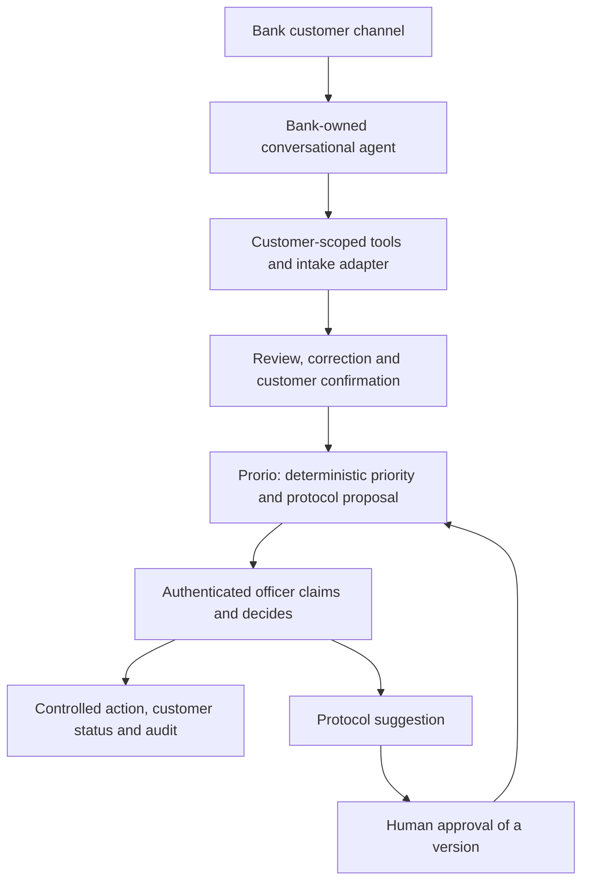

# Bank-owned agent deployment

## Deployment direction

SpeedQ's hackathon implementation combines a Retell-backed Clario voice/chat integration, deterministic Prorio prioritisation and an officer decision workspace. The proposed bank deployment places the conversational agent under the bank's ownership: the bank builds and operates its own orchestration, approved knowledge sources, customer-session integration and tool policies within its chosen infrastructure.

A bank could host speech recognition, model inference, retrieval and speech synthesis within its own environment, or select services approved by its governance process. Retell is the implemented hackathon integration, rather than a requirement to adopt the SpeedQ workflow or share the team's service account.

**Bank-owned does not require training a foundation model from zero.** A custom agent can combine existing models with bank-authored orchestration and controls. These components can communicate through authenticated internal APIs. API usage and API credentials describe interfaces and access control; they do not determine who owns the agent or where customer data is processed.

This is a proposed deployment design. It is separate from the runnable Retell adapter included in this repository; a bank-specific voice/chat adapter and production integrations would be engineering work for that deployment.

## Preserve the decision boundaries

The conversational model gathers and explains the need. The backend validates structured facts, checks owned evidence and computes priority. Officer decisions and approved protocol versions remain separate from conversational model output.

## Where an adapter connects

The existing code provides concrete examples of the boundary, rather than a production-ready provider-switching framework:

| Boundary | Existing implementation | Bank-owned adaptation |
|---|---|---|
| Conversation/session | Retell web/chat sessions and in-memory mapping in `backend/clario_live.py` | Bind a bank-authenticated session to the customer and conversation; use durable state appropriate to the deployment |
| Read-only context | Server-supplied masked synthetic context and signed `lookup_customer` calls | Retrieve permitted records through bank-controlled, least-privilege tools |
| Draft lifecycle | `POST /intake/drafts`, updates and confirmation, plus cancellation/revision checks | Implement the same confirmation and retry semantics behind the bank's own identity and service authorisation |
| Corrections | The current `correct_card` tool updates the associated open case | Preserve customer/case association and record corrections without permitting cross-customer writes |
| Ranking and proposals | Structured fields, owned evidence, active protocols and deterministic Prorio rules | Retain server authority over scores and protocol decisions; evaluate/calibrate the rules for the intended bank use |
| Officer outcome | Claims, revisions, approve/modify/manual handling and audit history | Integrate staff identity/roles and controlled banking adapters; validate approvals before real effects |

The Retell API key and agent IDs are needed for the current live Retell mode. A replacement bank-owned adapter would use its own service identities and credentials. The current `/retell/tools/{name}` signature verifier authenticates Retell requests; a replacement adapter needs the bank's own authenticated transport and authorisation. It is not enough to change an agent ID or remove signature checks.

The exact prototype schemas and routes are documented in the [technical reference](reference/TECHNICAL_REFERENCE.md) and [backend/models.py](../backend/models.py). The final-card webhook is a separate intake alternative; implementing a new adapter does not automatically make the prototype endpoints production-ready.

## Safety responsibilities in a bank implementation

| Responsibility | Required design property |
|---|---|
| Customer identity and consent | Bind tool access to a verified bank session. Record confirmation through a trusted application flow; a model's statement alone is insufficient evidence of identity or consent. |
| Data access and retention | Retrieve only authorised customer records; minimise model context, redact operational logs and define transcript retention and processing location. |
| Model authority | Validate model outputs as untrusted input. Keep score computation, transaction ownership, action allowlists and authorisation in controlled services. |
| Real actions | Apply bank-required authentication, approvals and audit controls before effects; the prototype's simulated protection, recalls and callbacks are examples, not live bank adapters. |
| Staff and protocol governance | Separate staff roles and protocol approval permissions, authenticate decision actors and version approved changes. |
| Reliability and escalation | Replace process-local coordination as needed, monitor failures and verify staffed fallback/transfer routes. Evaluate voice quality, language behaviour and the complete customer-to-officer journey. |

A deployment's safety depends on these controls and their validation. Bank ownership or self-hosting alone is not a security certification. The repository demonstrates the workflow and engineering boundaries using synthetic data; the bank would assess the proposed deployment against its own security, operational and regulatory requirements.

## Historical voice design

The supplied 16 November 2026 voice-agent document is historical context. It records earlier prompt-based scoring, embedded demonstration records and post-call extraction. Current code instead treats the backend score as authoritative, supplies scoped synthetic context and signed lookup tools, and supports live draft/confirmation/correction tools.

The old document's draft status, score bands, wait-time wording and placeholder transfer details do not establish the current implementation or what succeeded in the final submitted recording. See [live-service evidence and configuration](live-services.md) for the current scope. Private dashboard links and the raw planning document are not required to describe this architecture publicly.
