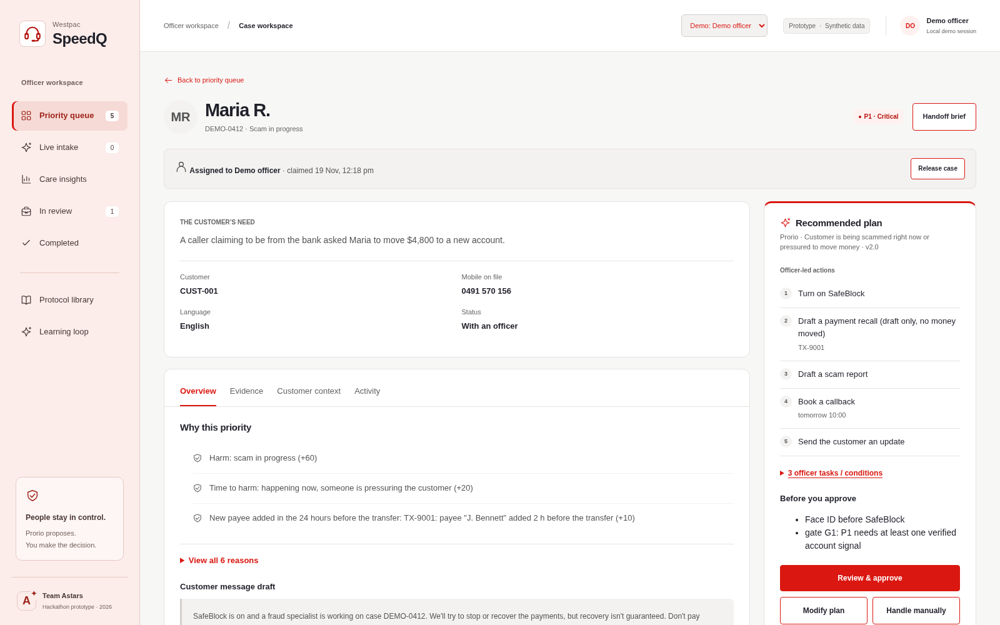

# Reproduce the demonstration

Follow [BUILD.md](../BUILD.md), then open `/demo` on that same computer. No external AI key is required for the scripted scenes. Use a separate database if you want a disposable rehearsal.

## Officer-first view

The wrapper starts with the officer workspace at full width. **Live intake → View customer conversation** opens an optional customer preview. It is not a permanent chat column. The standalone `/customer` route is a separate customer application.

## Maria: an urgent scam

1. Open the customer preview and select Maria's scripted scene; advance the conversation controls.
2. Observe the intake draft. Before confirmation it is not a ranked operational case.
3. Confirm the read-back; inspect Maria in the priority queue and open the preview.
4. Explicitly review/pick up the case. Read the priority reasons, linked evidence, proposed actions and required checks.
5. Approve, modify or handle manually. All effects are simulated; observe the recorded outcome and audit trail.

## Sam: a routine delivery question

Select Sam's scene. His synthetic record supplies a delivery answer. In this scripted flow Sam then asks for a person, so the confirmed card enters the queue at **P4**, awaiting approval. Do not describe this escalation scene as “Sam never queues”. A fully answered routine enquiry may finish during intake instead.

## Two officers

Open two officer sessions/tabs in local demo mode and select distinct demo identities. Pick up a case in one. The other sees the ownership update and cannot decide it until release/handoff. Completed work records the acting officer. Local identity selection is simulation, not customer or staff authentication.

## Explore without a conversation

Use **Load sample cases → Add sample cases**. Search, filter and select a case, then open **Care insights** to drill into charts computed from the stored queue. Loading samples is additive and does not reset saved work.

## Historical submission versus reproduction

[The submitted video and final deck](submission/README.md) record the 17 November 2026 presentation. These instructions describe the current repository. The recording's exact live voice/chat scope needs team confirmation; automated fake-client checks are not evidence that a live phone transfer succeeded.

## Officer review screen

