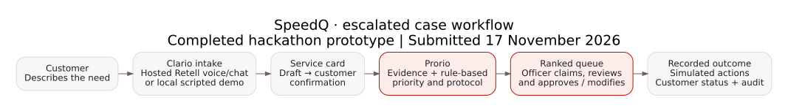

# From whiteboard to working prototype

The supplied whiteboard and 16 November 2026 context notes explain the team's original routing idea. This page maps that idea to the completed SpeedQ implementation. The context document is a historical planning record; its earlier names, deadlines and assistant instructions are not current project instructions.

[Download the PNG](../assets/diagrams/pipeline.png) · [Editable SVG](../assets/diagrams/pipeline.svg) · [Technical component architecture](architecture.md)

## Four ways a conversation can start

| Intent from the whiteboard | Intended response | Implementation boundary |
|---|---|---|
| Account question | Look up the customer's relevant records and answer; escalate if more help is needed | Customer-scoped tools and synthetic delivery/account records are included. The scripted Sam scene demonstrates a routine answer followed by an officer request. |
| General question | Answer from a configured knowledge base; escalate if it cannot resolve the need | Knowledge-base content and conversational policy belong to the externally configured Retell agent. A complete hosted export is not in this repository. |
| Urgent concern | Capture the need, consider protective steps and prepare the service card | Structured issue/caller cues and owned account evidence inform the backend. A keyword alone does not establish P1 priority; protection effects remain simulated. |
| Request for a person | Collect enough context for triage and prepare the card | The escalation route is represented in the customer flow. Exact live dialogue depends on the configured agent. |

The chart describes product routing, not a claim that every branch runs without external configuration. Local scripted scenes reproduce selected journeys; hosted voice/chat requires the owner's Retell setup. An answered intake conversation can finish without becoming an officer case.

## Every escalation passes through the card

A developing card is an unranked draft. The customer can review and correct it before confirmation. Only then does it become an operational case for Prorio. The same rule applies to an urgent concern or a request for a person; neither arrow skips confirmation in the diagram.

The local scene confirms explicitly. In the live adapter, confirmation is represented by the signed agent tool call after its read-back; the backend does not independently establish real-world identity or consent. Corrections to a submitted open card use the associated case path.

## Prorio proposes; the officer decides

Prorio uses structured fields, owned synthetic evidence, configured gates, waiting time and active protocols. It produces priority reasons and a protocol proposal. Free-text summaries do not enter its ranker.

| Current band | Score |
|---|---:|
| P1 Critical | 80–100 |
| P2 High | 60–79 |
| P3 Medium | 40–59 |
| P4 Low | 0–39 |

The officer explicitly claims the case, reviews the proposal and chooses **Approve**, **Modify** or **Manual**. Ownership and revision checks protect shared work. Approved/modified actions are simulated; manual work remains open until its outcome is recorded. The customer status and audit history reflect saved results.

## Feedback changes a version, not a model

Officer modifications or manual handling can produce suggestions. A suggestion must meet the configured threshold and receive human approval before a new protocol version becomes active. Later proposals use that active version. This is reviewed rule management, not automatic model training or immediate rewriting of the base JSON file.

## What changed after the sketch

| Earlier sketch / notes | Current description |
|---|---|
| Beacon Assist and other working names | SpeedQ, presented in its Westpac hackathon context |
| Prorio drawn as an “AI agent” | Deterministic Python priority/protocol engine |
| Rough three-band score notes | Four implemented bands shown above |
| Actions executed against a bank | Mock effects and draft records; no real bank connection or money movement |
| Decisions written directly into a learning database | Human-reviewed, versioned protocol suggestions |
| Signed-in bank app, Face ID and automatic language handling | Product concepts; no production bank login or biometric integration is implemented. Live channel behaviour requires external service configuration and validation. |

The final deck remains a [dated submission artifact](submission/README.md); it is not silently edited to match later documentation. The raw context file includes unrelated personal planning and superseded instructions, so this page records the useful design facts instead of publishing that file wholesale.
